<p align="center">
  
</p>
<h1 align="center">FileRun Web</h1>
<p align="center">
  A self-hosted file sharing application in the spirit of <a href="https://filerun.com">FileRun</a>: your files, on your own server, with sharing, links, versions, previews, WebDAV and a full audit trail.<br>
  Plain PHP + MySQL. No framework, no build step, no cloud.
</p>

<p align="center">
  <a href="https://github.com/gextam/filerun-web/releases"></a>
  
  
  
  
  <a href="https://gextam.github.io/filerun-web/"></a>
</p>

<p align="center">
  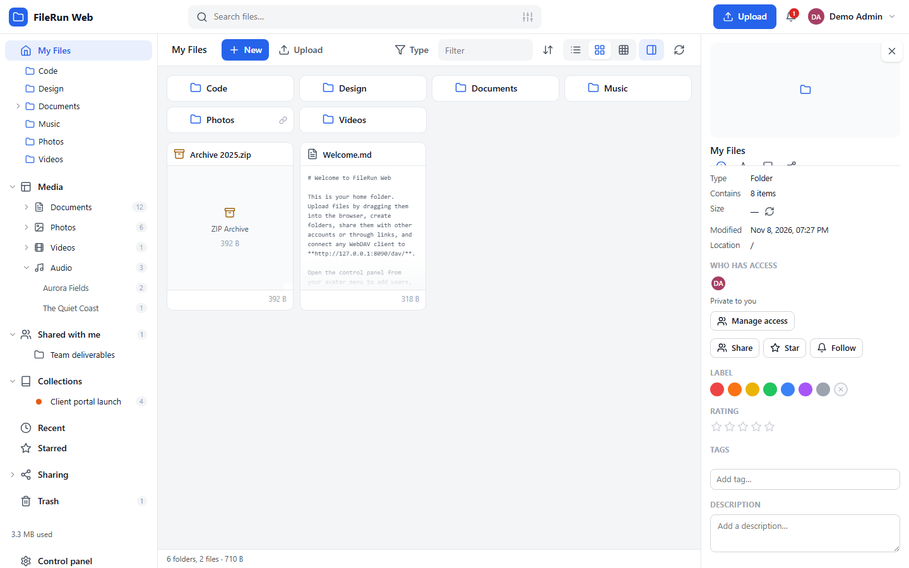
</p>

> **Trademark note.** FileRun is a trademark of FileRun Lda. This project is an independent, unaffiliated re-implementation of the feature set described on filerun.com, written from scratch for learning and self-hosting. It shares no code with FileRun and is not endorsed by its authors.

---

## ✨ Features

**Working with files**
- Fast file browser with list, grid and gallery views, column sorting, a type filter, type-ahead selection, drag & drop to move or copy, cut / copy / paste, inline rename, keyboard shortcuts. Grid cards show thumbnails, the first lines of text files, or the file type and size.
- **Media library**: the sidebar automatically organises everything you own into Documents (Office, spreadsheets, presentations, PDF, text, code, e-books), Photos and Videos (by year, from EXIF dates when available) and Audio (by artist, read from ID3 / FLAC / container tags with ffprobe), wherever the files live.
- **Collections**: gather files from any folder, or from items shared with you, in named virtual folders without moving anything.
- Preview almost anything in the browser: images (with zoom and slideshow), video and audio, PDF (pdf.js), Markdown, text and source code with syntax highlighting, CSV / XLSX tables, DOCX documents, fonts, and a look inside ZIP / TAR archives without unpacking them.
- Built-in **text / code editor** (CodeMirror, Ctrl+S, conflict detection) and **image editor** (rotate, flip, crop, resize, save as copy).
- **File versions**: every overwrite or edit keeps the previous content; restore or download any version.
- **Trash** with restore (to the original or another folder), automatic emptying after a retention period.
- **Lock** a file while you work on it; locks are honoured by the web UI, the API and WebDAV.
- Stars, colour labels, star ratings, tags, descriptions, comments, and **custom metadata fields** (text, number, date, select, boolean, URL) per file type, shown as columns and searchable.
- EXIF / IPTC / XMP read on upload (camera, lens, exposure, GPS, keywords) without the PHP exif extension.
- Create blank Word documents and spreadsheets, Markdown notes and text files from the New menu.

**Sharing**
- Share with users or **groups** with one of seven roles: Viewer, Commenter, Editor, Contributor, Distributor, Content manager, Uploader. The folder appears under *Shared with me*; nothing is copied.
- Share with an **e-mail address**: a guest account is created automatically and removed when its last share goes away.
- **Public links** with password, expiry date, download limit, terms to accept, "preview only", notifications, QR code and e-mail sending. Visitors get the full interface, not a bare download page.
- **File requests**: a link with the Uploader role only accepts uploads.
- One switch turns every public link on the server off at once.
- Follow a folder and get notified (in-app and by e-mail) about uploads, edits, comments and deletions.

**Uploads**
- Resumable **chunked uploads** that are not limited by PHP's `upload_max_filesize`; interrupted transfers resume where they stopped.
- Drag & drop files **and folders** from the desktop, paste images from the clipboard (screenshot → upload → link copied), classic multipart upload for API clients.
- **Folder sync on upload**: files that already exist with the same size and time are skipped, changed ones replace the old version (which is kept in the history).

**Getting to your files**
- **WebDAV** server (class 1 + 2) with per-device **app passwords**: mount as a network drive in Windows Explorer or macOS Finder, or use rclone, Cyberduck, Mountain Duck, GoodSync…
- **JSON API** with an OpenAPI 3 description and Bearer tokens (app passwords).
- Installable **PWA** for phones (home-screen app, share target).

**Security**
- Argon2id password hashing, progressive sign-in throttling, per-account IP restrictions, session list with remote sign-out, changing a password signs out every other session.
- **Two-step verification**: TOTP authenticator apps, e-mailed codes (on by default for accounts with an e-mail address), recovery codes; administrators can make a second factor mandatory. Five failed attempts deactivate the account.
- **Passkeys** (WebAuthn): sign in with a fingerprint, face, PIN or security key.
- **OpenID Connect** sign-in (Keycloak, Authentik, Authelia, Entra ID, Google…) with PKCE and automatic account creation.
- Every action is written to the **activity log** with IP address, client (web, WebDAV, API, link, system), status and reason; names survive renames and deletions; CSV export.

**Running it**
- Users, groups, storage and traffic quotas, maximum upload size, allowed file types, account end dates, forced password changes, per-account feature permissions.
- **Delegated administration**: an *admin* only manages the accounts they created and cannot hand out more storage than they own.
- Branding: name, logo, favicon, accent colour, light / dark / system theme, custom CSS, **custom wording** for any phrase; privacy and terms links.
- Translations: English, Spanish, German, French, Portuguese bundled; drop a JSON file in `assets/lang/` to add a language.
- Content indexing for search inside documents (plain text, PDF via `pdftotext`, Office / OpenDocument files, optional OCR via `tesseract`), maintenance cron, e-mail via `mail()` or SMTP, ONLYOFFICE Document Server connector, optional Google Docs viewer.

## 🖥️ Platforms

| Component | Supported |
|-----------|-----------|
| Server | Linux, Windows or macOS with PHP 8.1 – 8.4 and MySQL 8 / MariaDB 10.6+; Apache (`.htaccess` included), Nginx or PHP-FPM behind any proxy; shared hosting / cPanel works |
| PHP extensions | required: `pdo_mysql`, `mbstring`, `json`, `openssl` · optional: `gd` (thumbnails, image editor), `zip` (archives, zip downloads, DOCX/XLSX templates), `curl` (SSO, office editors), `fileinfo` |
| Optional tools | `ffmpeg` (video/audio thumbnails), GraphicsMagick/ImageMagick (TIFF, PSD, RAW, HEIC thumbnails), `pdftoppm` / `gs` (PDF thumbnails), `pdftotext` (PDF indexing), `tesseract` (OCR), `7z` / `unrar` (listing those archives) |
| Browsers | Current Chrome, Edge, Firefox, Safari; mobile browsers (responsive layout, PWA) |
| WebDAV clients | Windows Explorer, macOS Finder, GNOME Files, rclone, Cyberduck, Mountain Duck, WinSCP, GoodSync, davfs2 |

## 🚀 Installation

1. **Upload** the contents of this repository to your web server. It can be the document root (`https://files.example.com/`) or a sub folder (`https://example.com/files/`).
2. **Create a MySQL database** and a user with all privileges on it.
3. **Open the site** in a browser. The installer at `/setup` checks the server, asks for the database, a data folder (keep it *outside* the web root), the public URL and the first administrator, then writes `config.php`.

   Prefer the command line? The same thing, non-interactively:
   ```bash
   php bin/install.php --db-name=filerun --db-user=filerun --db-pass=secret \
     --admin-user=admin --admin-pass='Str0ngPass!' --admin-email=you@example.com \
     --data-dir=/var/filerun-data --public-url=https://files.example.com
   ```
4. **Add the cron job** the installer prints (every minute). It processes the indexing queue, empties the trash, purges expired links and sessions, deactivates expired accounts and recalculates usage:
   ```
   * * * * * php /path/to/filerun-web/app/cron.php >/dev/null 2>&1
   ```
   Without cron the application still works: a few jobs are processed at the end of web requests.
5. **Apache** reads the included `.htaccess` (needs `mod_rewrite`; `AllowOverride All`). **Nginx** users add:
   ```nginx
   location / { try_files $uri $uri/ /index.php?$query_string; }
   location ~ ^/(app|bin)/ { deny all; }
   location ~ ^/(config\.php|\.user\.ini) { deny all; }
   client_max_body_size 64m;
   ```
6. Sign in, open **Control panel → Settings** and set up e-mail (so that codes, invitations and notifications can be sent), then add users or enable OpenID Connect.

### Configuration reference (`config.php`)

| Key | Meaning | Default |
|-----|---------|---------|
| `db.host`, `db.port`, `db.name`, `db.user`, `db.pass` | MySQL connection | from the installer |
| `db.prefix` | table name prefix (lets the app share a database) | `fr_` |
| `db.socket` | UNIX socket instead of host/port | `''` |
| `data_dir` | folder for user files, versions, trash, thumbnails, temp and logs | `<app>/data` |
| `secret` | random key for signed tokens (public viewer links, office callbacks) | generated |
| `public_url` | URL used in e-mails and links; `null` = detect from the request | detected |
| `debug` | show error details in API responses | `false` |
| `trusted_proxies` | IPs / CIDRs whose `X-Forwarded-For` / `CF-Connecting-IP` headers are trusted | `[]` |
| `asset_url` | URL of the app folder when it cannot be detected | auto |
| `binaries` | overrides such as `['ffmpeg' => '/opt/ffmpeg/bin/ffmpeg']` | `[]` |
| `webauthn_rp_id` | passkey relying party id | host name |

Everything else (branding, security policy, sharing rules, quotas for new accounts, e-mail transport, integrations, retention) is edited in **Control panel → Settings** and stored in the database. PHP limits for uploads come from the included `.user.ini` / `.htaccess` (64 MB per chunk); the chunk size adapts automatically to `post_max_size`.

## 📖 User guide

### Signing in
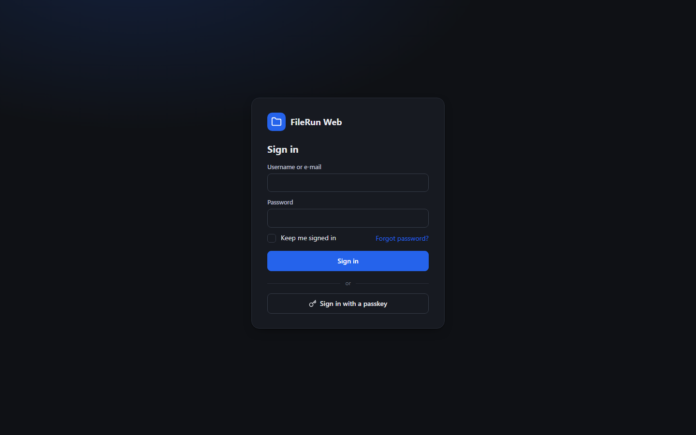

Sign in with your username (or e-mail) and password. If a second factor applies, enter the code from your authenticator app or the one e-mailed to you; recovery codes work too. Accounts with a passkey can skip the password entirely, and servers with single sign-on show an SSO button.

Forgot your password? The link under the form e-mails you a reset link (if the administrator allows it). Changing or resetting a password signs out every other session.

<br clear="right">

### Browsing
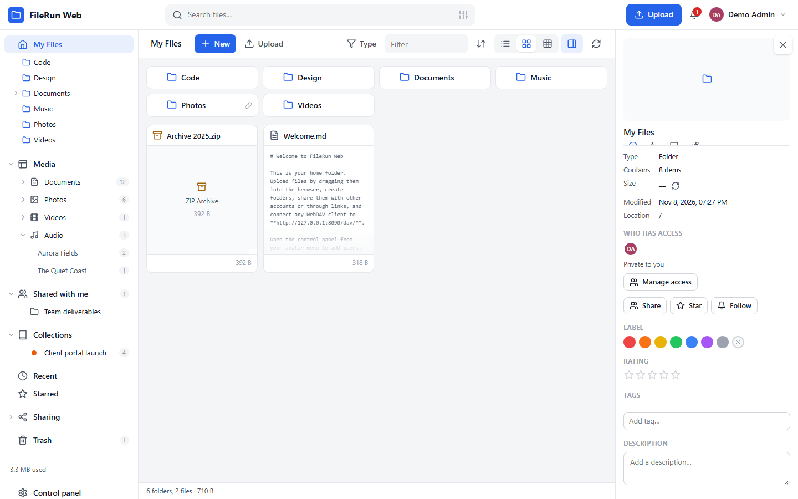

The sidebar has your folder tree under **My Files**, a **Media** library that sorts every file you own by type (Documents › Office / Spreadsheets / Presentations / PDF / Text / Code / E-books, Photos and Videos by year, Audio by artist), **Shared with me**, your **Collections**, Recent, Starred, a **Sharing** section (with people, public links, file requests) and the Trash. Every group expands and collapses, and the whole sidebar can be hidden with the button in the top left.

*My Files* is your home folder. Switch between **list, grid and gallery** with the buttons on the right of the toolbar or keys `1` `2` `3`; sort with the column headers or the sort menu; type to jump to a name; filter the current folder with the box in the toolbar. Double-click opens folders and previews files; right-click opens the context menu; the **details panel** (`I`) shows information, activity, comments, versions and sharing for the selected item.

Drag items onto folders in the list, the tree or the breadcrumbs to move them (hold Ctrl to copy). *Photos*, *Recent*, *Starred* and tag / label views are virtual folders built from the search index.

### Previewing and editing
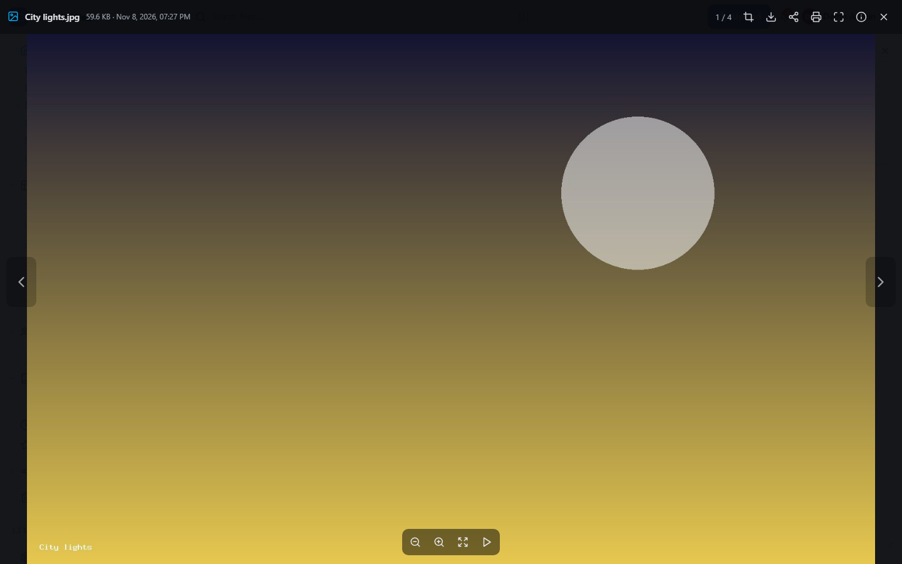

The viewer opens images, video, audio, PDFs, Markdown, text, code, spreadsheets, documents, fonts and archives. Use `←` `→` to move through the folder, the magnifier buttons or the mouse wheel to zoom, and the toolbar to download, share, print or open the file in the office editor (when ONLYOFFICE is configured). *Edit* turns text and Markdown files into a code editor with syntax colouring; *Edit image* rotates, flips, crops and resizes pictures. Every save keeps the previous content in **Versions**.

### Uploading
Click **Upload** or drag files and folders anywhere into the folder view. Uploads are sent in resumable chunks, several at a time, with a progress panel in the corner; folder uploads compare size and date and skip files that have not changed. Press Ctrl+V in a folder to upload an image from the clipboard; the *Upload → Paste image* menu does the same and copies a public link to it when you are allowed to create links.

### Sharing with people
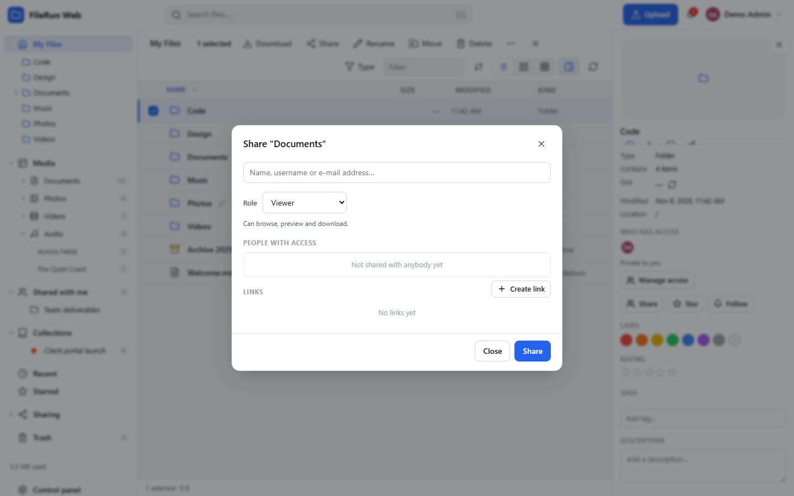

Right-click → **Share…** (or the Share button in the details panel). Search for users or groups, pick a **role**, and share. People see the item under *Shared with me*. Typing an e-mail address invites somebody without an account: a guest account is created and the credentials are e-mailed. Roles:

| Role | Can |
|------|-----|
| Viewer | browse, preview, download |
| Commenter | … and comment |
| Editor | … and edit existing files and their metadata |
| Contributor | … and upload / create new files and folders |
| Distributor | view and share further (links, re-shares) |
| Content manager | full control of the content: upload, edit, rename, move, delete |
| Uploader | only add files; cannot see or download what is there (file requests) |

### Collections
Right-click any files or folders and choose **Add to collection** (or create a new one on the spot). A collection is a virtual folder: the files stay where they are, and the same file can be in several collections. Open *Collections* in the sidebar to browse, rename, recolour or delete them.

### Public links
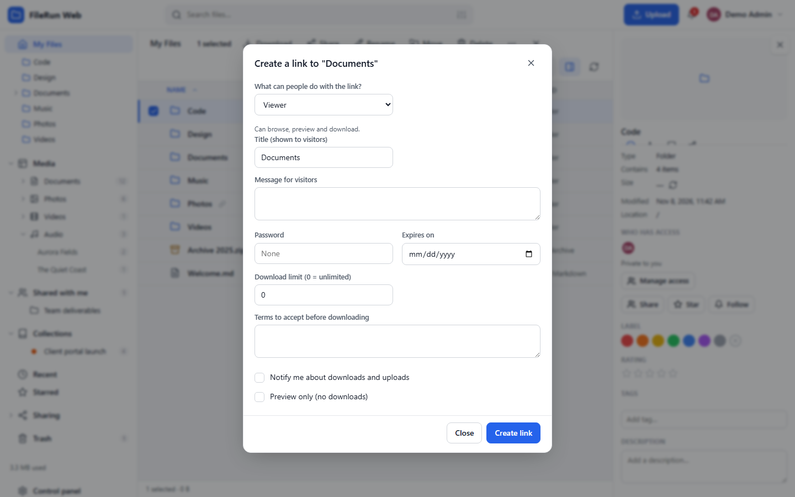

**Get link…** creates a link anybody can open. Options: role (viewer, uploader = file request, editor…), title and message, password, expiry date, download limit, terms the visitor must accept, "preview only", notifications. The link is copied to the clipboard; send it by e-mail or show it as a QR code. *My links* lists every link with its statistics; administrators can disable all links on the server with a single switch.

### Searching
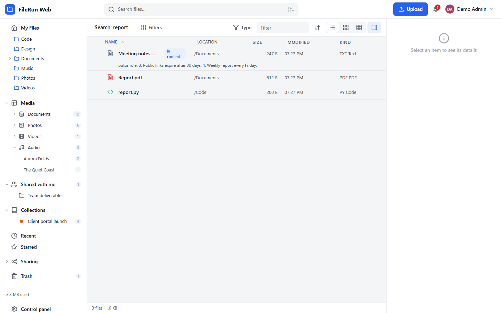

The search box looks at file names, inside documents (text, PDF, Office, OpenDocument and, when OCR is enabled, scanned images), descriptions, tags and custom metadata. The sliders icon opens **advanced search** (type, extension, date range, size range, search inside the current folder).

### Your account
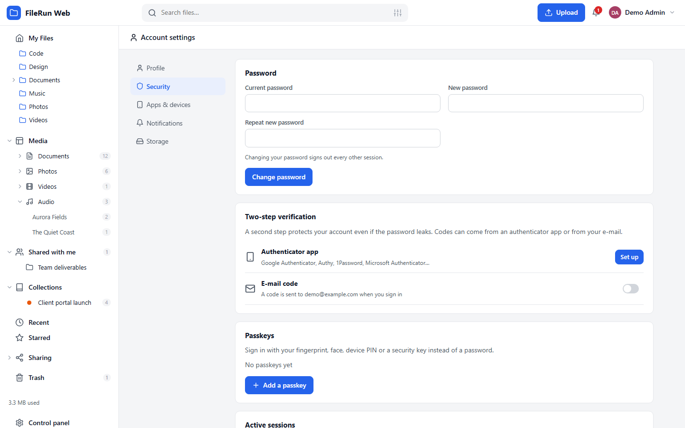

*Account settings* holds your profile and language, password, two-step verification (authenticator app, e-mail codes, recovery codes), passkeys, active sessions, notification preferences and storage statistics. **Apps & devices** shows the WebDAV address and manages **app passwords**: create one per device or program, revoke it when the device is gone.

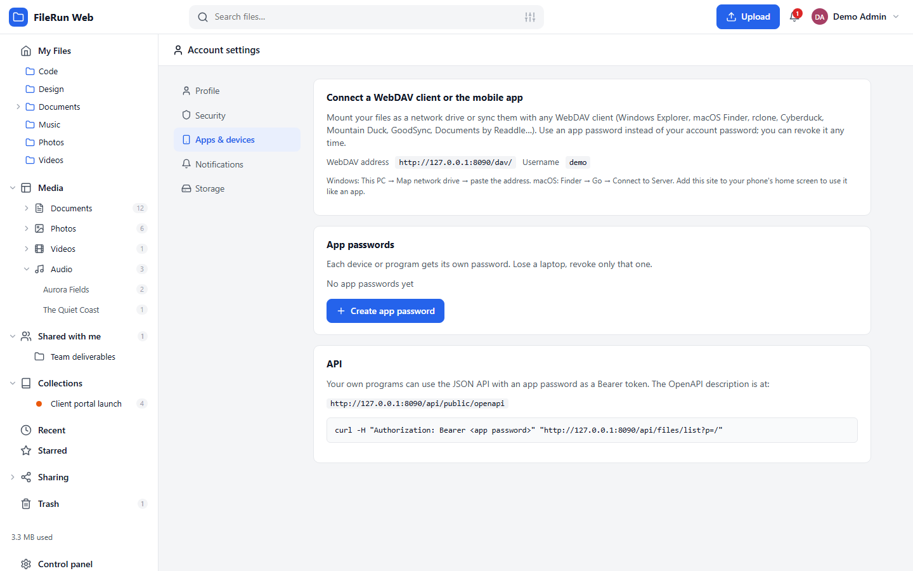

### Control panel
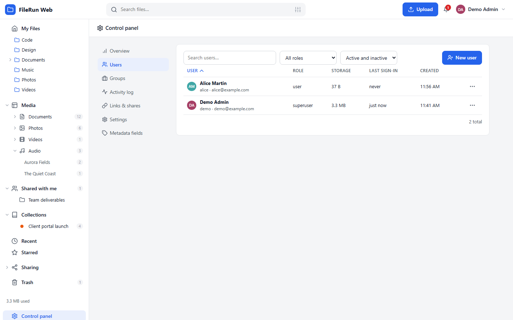

Administrators manage users (role, home folder, quotas, upload limits, allowed file types, end date, IP rules, per-feature permissions, groups, 2FA reset, "sign in as"), groups, custom metadata fields, every setting, all links and shares, and the **activity log** with filters and CSV export. The overview shows server health, installed tools and the cron status.

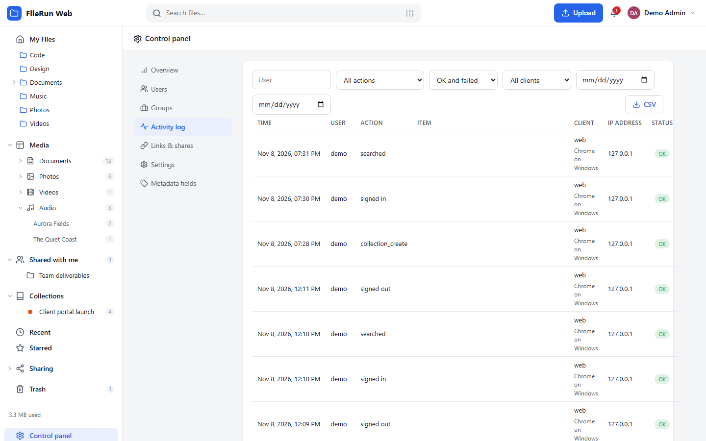

<details>
<summary><b>Keyboard shortcuts</b></summary>

| Keys | Action |
|------|--------|
| `↑` `↓` (`←` `→` in grid) | Move the selection |
| `Enter` | Open folder / preview file |
| `Space` | Quick preview |
| `Backspace` | Go to the parent folder |
| `Ctrl+A` | Select all |
| `Delete` | Delete (to the trash) |
| `F2` | Rename |
| `Ctrl+C` / `Ctrl+X` / `Ctrl+V` | Copy / cut / paste items (`Ctrl+V` with an image in the clipboard uploads it) |
| `Shift+N` | New folder |
| `U` | Upload files |
| `/` | Focus the search box |
| `I` | Toggle the details panel |
| `1` / `2` / `3` | List / grid / gallery view |
| `Esc` | Clear selection, close menus and dialogs |
| `←` `→` (viewer) | Previous / next file |
| `Ctrl+S` (editor) | Save |

</details>

## 🔌 WebDAV and API

- WebDAV address: `https://your-host/dav/`. Sign in with your username and an **app password** (Account → Apps & devices). Accounts with an authenticator app can only use app passwords.
- API: `https://your-host/api/public/openapi` describes every endpoint. Authenticate with `Authorization: Bearer <app password>` (or HTTP Basic). Paths are virtual: `/folder/file.txt` in your home, `@17/sub` inside share #17.
  ```bash
  curl -H "Authorization: Bearer frw_..." "https://your-host/api/files/list?p=/Documents"
  curl -H "Authorization: Bearer frw_..." -X POST -H "Content-Type: application/json" \
       -d '{"p":"/","name":"New folder"}' https://your-host/api/files/mkdir
  ```

## ⚠️ Known limitations

- No desktop sync client or native mobile apps are included; use WebDAV clients (rclone, Mountain Duck, GoodSync…) and the PWA instead.
- Office documents are edited collaboratively only when an **ONLYOFFICE Document Server** is configured; without it DOCX files are shown read-only (Mammoth) and spreadsheets as tables (SheetJS). PowerPoint files have no built-in preview unless the Google viewer is enabled.
- Full-text search uses MySQL / MariaDB `FULLTEXT` instead of Elasticsearch + Tika; results are good for office documents and PDFs but there is no relevance tuning or stemming across languages.
- OCR needs `tesseract` on the server and runs from cron; RAW camera previews need GraphicsMagick/ImageMagick with RAW delegates.
- Sign-in integrations: OpenID Connect only (covers Keycloak, Authentik, Authelia, Entra ID, Google, Okta…). LDAP / Active Directory binding and SAML are not implemented.
- Five languages are bundled instead of 35; the mechanism accepts any language file.
- Zip downloads of folders are built on the server before sending (8 GB limit).

## 🗂️ Project layout

```
filerun-web/
├── index.php             front controller (works at the web root or in a sub folder)
├── .htaccess, .user.ini  Apache rewrites, upload limits
├── app/
│   ├── bootstrap.php     autoload, config, URL bases, error handling
│   ├── api/              JSON API modules: auth, files, upload, shares, link, account, admin, public
│   ├── lib/              Auth, Users, Paths (virtual paths + roles), Storage, Meta, Index, Indexer,
│   │                     Shares, Links, Notify, Activity, Thumbs, Exif, Archive, Upload, WebDav,
│   │                     WebAuthn, Totp, Oidc, OnlyOffice, Mailer, Settings, Schema, Templates…
│   └── cron.php          maintenance entry point
├── assets/
│   ├── js/               ES-module SPA: app, files, preview, upload, share, account, admin, link, ui
│   ├── css/app.css       light / dark theme, layout, components
│   ├── lang/             translations (en is the key language)
│   └── vendor/           CodeMirror, pdf.js, Mammoth, SheetJS, qrcode-generator
├── bin/                  install.php (CLI installer), seed-demo.php, dev-router.php
├── tools/screenshots.mjs headless-Chrome screenshot tool for the docs
└── docs/                 GitHub Pages site and screenshots
```

## 🧪 Development

```bash
# local database (any MySQL/MariaDB works; a portable MariaDB on port 3307 is what we use)
FR_CONFIG=$PWD/config.local.php php bin/install.php --db-host=127.0.0.1 --db-port=3307 \
  --db-name=filerun_dev --db-user=root --db-pass=devroot --admin-user=demo --admin-pass='DemoPass123!' \
  --data-dir=$PWD/data --public-url=http://127.0.0.1:8090
FR_CONFIG=$PWD/config.local.php php bin/seed-demo.php demo      # sample folders, photos, documents
php -S 127.0.0.1:8090 -t . bin/dev-router.php                   # dev server with .htaccess emulation
```

- Syntax checks: `php -l` on `app/**/*.php`, `node --input-type=module --check < assets/js/*.js`.
- Screenshots for the docs: `node tools/screenshots.mjs --url=http://127.0.0.1:8090 --user=demo --pass='DemoPass123!'` (headless Chrome over the DevTools protocol, no npm packages).
- Coding style: PHP 8 `declare(strict_types=1)`, static service classes, one responsibility per file; front end in plain ES modules with a tiny `h()` DOM helper, no framework and no bundler.

## License

MIT. Third-party front-end libraries in `assets/vendor/` keep their own licenses (CodeMirror MIT, pdf.js Apache-2.0, Mammoth BSD-2, SheetJS Apache-2.0, qrcode-generator MIT).
